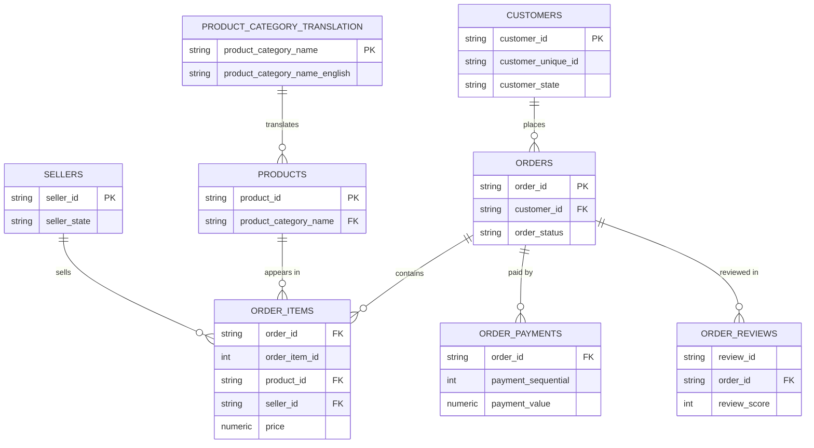

# Data Dictionary: Olist Brazilian E-Commerce Dataset

**Source:** Brazilian E-Commerce Public Dataset by Olist (Kaggle)
**Tables:** 9 CSV files, loaded into PostgreSQL
**Use of this document:** describes what each table and column means, and whether it is used in this project.

The "Used" column shows whether a column is used in the analysis: **Yes** (core to the analysis), **Maybe** (possibly used for segmentation or context), or **No** (not needed).

---

## 1. Table Overview

| Table | One row represents | Primary key | Used in project |
|---|---|---|---|
| `orders` | One customer order | `order_id` | Core |
| `order_items` | One item within an order | `order_id` + `order_item_id` | Core |
| `order_reviews` | One customer review of an order | `review_id` (not guaranteed unique, see notes) | Core |
| `customers` | One customer record per order | `customer_id` | Core |
| `sellers` | One seller | `seller_id` | Core |
| `products` | One product | `product_id` | Core |
| `product_category_name_translation` | One category name translation | `product_category_name` | Core |
| `order_payments` | One payment entry for an order | `order_id` + `payment_sequential` | Supporting |
| `geolocation` | One latitude/longitude record for a zip prefix | None (many rows per zip prefix) | Not used |

## 2. Relationships

| From | To | Join column | Cardinality |
|---|---|---|---|
| `customers` | `orders` | `customer_id` | One to many (in practice one to one, see notes) |
| `orders` | `order_items` | `order_id` | One to many |
| `orders` | `order_payments` | `order_id` | One to many |
| `orders` | `order_reviews` | `order_id` | One to many (some orders have more than one review) |
| `products` | `order_items` | `product_id` | One to many |
| `sellers` | `order_items` | `seller_id` | One to many |
| `product_category_name_translation` | `products` | `product_category_name` | One to many |

---

## 3. Table Definitions

### 3.1 `orders`

One row per order. This is the central table.

| Column | Type | Description | Used |
|---|---|---|---|
| `order_id` | text | Unique order identifier | Yes |
| `customer_id` | text | Customer record for this order. Generated per order, so it links to `customers` | Yes |
| `order_status` | text | Order status: `delivered`, `shipped`, `canceled`, `unavailable`, `invoiced`, `processing`, `created`, `approved` | Yes |
| `order_purchase_timestamp` | timestamp | When the customer placed the order | Yes |
| `order_approved_at` | timestamp | When payment was approved | No |
| `order_delivered_carrier_date` | timestamp | When the order was handed to the logistics partner | Maybe |
| `order_delivered_customer_date` | timestamp | When the customer received the order | Yes |
| `order_estimated_delivery_date` | timestamp | Delivery date promised to the customer at purchase | Yes |

**Notes**
- Lateness is only defined for delivered orders with a non-null `order_delivered_customer_date`.
- `order_estimated_delivery_date` usually has no time of day. Compare dates, not timestamps.
- `order_delivered_carrier_date` could be used to split delay into seller handling time and carrier transit time.

### 3.2 `order_items`

One row per item in an order. An order with three items has three rows.

| Column | Type | Description | Used |
|---|---|---|---|
| `order_id` | text | Order this item belongs to | Yes |
| `order_item_id` | integer | Sequence number of the item within the order (1, 2, 3, ...) | Yes |
| `product_id` | text | Product sold | Yes |
| `seller_id` | text | Seller who fulfils this item | Yes |
| `shipping_limit_date` | timestamp | Deadline for the seller to hand the item to the carrier | Maybe |
| `price` | numeric | Item price in BRL | Yes |
| `freight_value` | numeric | Freight cost for the item in BRL | Maybe |

**Notes**
- An order can contain items from different sellers, so one order can map to several sellers.
- `freight_value` is excluded from the revenue measure.
- `shipping_limit_date` compared with `order_delivered_carrier_date` shows whether the seller shipped on time.

### 3.3 `order_reviews`

Customer satisfaction survey results.

| Column | Type | Description | Used |
|---|---|---|---|
| `review_id` | text | Review identifier | Yes |
| `order_id` | text | Order being reviewed | Yes |
| `review_score` | integer | Satisfaction score from 1 (worst) to 5 (best) | Yes |
| `review_comment_title` | text | Optional comment title | No |
| `review_comment_message` | text | Optional free-text comment (Portuguese) | Maybe |
| `review_creation_date` | timestamp | When the survey was sent | Yes |
| `review_answer_timestamp` | timestamp | When the customer answered | Maybe |

**Notes**
- Some orders have more than one review, and `review_id` may repeat. The analysis keeps the latest review per order by `review_creation_date`.
- Many reviews have no comment text. Missing comments are normal.
- Comment text could support a sentiment analysis in a later extension of the project.

### 3.4 `customers`

| Column | Type | Description | Used |
|---|---|---|---|
| `customer_id` | text | Key used by `orders`. Generated per order | Yes |
| `customer_unique_id` | text | Identifier of the actual customer, constant across orders | Maybe |
| `customer_zip_code_prefix` | text | First five digits of the customer's zip code | No |
| `customer_city` | text | Customer city | Maybe |
| `customer_state` | text | Two-letter Brazilian state code, for example SP | Yes |

**Notes**
- `customer_id` is not a stable customer identity. Use `customer_unique_id` for any repeat-customer analysis.
- State is the main regional dimension in this project.

### 3.5 `sellers`

| Column | Type | Description | Used |
|---|---|---|---|
| `seller_id` | text | Unique seller identifier | Yes |
| `seller_zip_code_prefix` | text | First five digits of the seller's zip code | No |
| `seller_city` | text | Seller city | Maybe |
| `seller_state` | text | Two-letter Brazilian state code | Maybe |

**Notes**
- Seller state versus customer state can be used to test whether longer shipping distances drive delays.

### 3.6 `products`

| Column | Type | Description | Used |
|---|---|---|---|
| `product_id` | text | Unique product identifier | Yes |
| `product_category_name` | text | Category name in Portuguese | Yes |
| `product_name_lenght` | integer | Number of characters in the product name | No |
| `product_description_lenght` | integer | Number of characters in the product description | No |
| `product_photos_qty` | integer | Number of product photos | No |
| `product_weight_g` | numeric | Product weight in grams | Maybe |
| `product_length_cm` | numeric | Product length in cm | Maybe |
| `product_height_cm` | numeric | Product height in cm | Maybe |
| `product_width_cm` | numeric | Product width in cm | Maybe |

**Notes**
- The source columns `product_name_lenght` and `product_description_lenght` contain a spelling error ("lenght"). The original names are kept so the data loads without renaming.
- Some products have a missing category.
- Weight and dimensions could be used to test whether bulky products are delivered late more often.

### 3.7 `product_category_name_translation`

| Column | Type | Description | Used |
|---|---|---|---|
| `product_category_name` | text | Category name in Portuguese | Yes |
| `product_category_name_english` | text | Category name in English | Yes |

**Notes**
- A few categories may be missing from this table. They are reported as "unknown" in the English category column.

### 3.8 `order_payments`

| Column | Type | Description | Used |
|---|---|---|---|
| `order_id` | text | Order being paid | Maybe |
| `payment_sequential` | integer | Sequence number when an order is paid with several methods | No |
| `payment_type` | text | Payment method, for example credit card, boleto, voucher, debit card | Maybe |
| `payment_installments` | integer | Number of installments chosen | No |
| `payment_value` | numeric | Amount paid in BRL | Maybe |

**Notes**
- An order can have several payment rows. Sum `payment_value` per order before joining to avoid duplicating rows.
- Revenue in this project is defined from item `price`, not from payments.

### 3.9 `geolocation`

| Column | Type | Description | Used |
|---|---|---|---|
| `geolocation_zip_code_prefix` | text | First five digits of the zip code | No |
| `geolocation_lat` | numeric | Latitude | No |
| `geolocation_lng` | numeric | Longitude | No |
| `geolocation_city` | text | City name | No |
| `geolocation_state` | text | State code | No |

**Notes**
- Each zip prefix appears many times, so joining this table directly would multiply rows.
- It is not used in this project. State columns from `customers` and `sellers` cover the regional analysis.
- It could support a distance-based extension (seller-to-customer distance), but that requires aggregating to one coordinate per zip prefix first.

---

## 4. Reference Values

**Order status values**

| Status | Meaning | In analysis scope |
|---|---|---|
| `delivered` | Delivered to the customer | Yes (if delivery date is present) |
| `shipped` | With the carrier, not yet delivered | No |
| `canceled` | Canceled | No |
| `unavailable` | Could not be fulfilled | No |
| `invoiced`, `processing`, `created`, `approved` | Earlier stages of the order lifecycle | No |

## 5. Verification Status

The descriptions above are based on the dataset documentation and a first inspection of the files. Row counts, duplicates, null rates, and the exact date range are verified during the data quality phase and recorded in `docs/data_quality_notes.md`.
